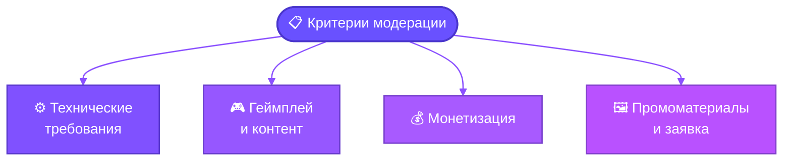

---
metadata:
  - name: generator
    content: Diplodoc Platform v5.64.0
  - name: robots
    content: noindex
alternate:
  - https://yandex.ru/dev/games/doc/ru/concepts/criteria.md
  - href: https://yandex.ru/dev/games/doc/ru/concepts/criteria.md
    type: text/markdown
    title: Markdown version
  - href: https://yandex.ru/dev/games/doc/ru/llms.txt?revision=r21827509
    rel: describedby
---
> **Documentation Index:** Fetch the complete configuration index at https://yandex.ru/dev/games/doc/ru/llms.txt?revision=r21827509

# Требования к игре

<!-- source: ru/_includes/script-common.md -->
<!-- source: ru/_includes/script/index-js.md -->

<!-- endsource: ru/_includes/script/index-js.md -->

<!-- source: ru/_includes/script/requirements-js.md -->

<!-- endsource: ru/_includes/script/requirements-js.md -->

<!-- source: ru/_includes/script/image-modal-js.md -->

<!-- endsource: ru/_includes/script/image-modal-js.md -->
<!-- endsource: ru/_includes/script-common.md -->

Перед публикацией в [каталоге Яндекс Игры](https://yandex.ru/games/){.external} каждая игра проходит модерацию — так мы поддерживаем стабильный и качественный игровой опыт для миллионов пользователей на разных устройствах и при любом типе подключения.

На странице дан обзор основных пунктов Требований к игре, сгруппированных по темам, — используйте его, чтобы быстро сориентироваться перед подготовкой игры. Это не исчерпывающий список: перед публикацией сверьтесь с [Полным списком требований](https://yandex.ru/dev/games/doc/ru/concepts/requirements.md).

Требования разделены по уровням реализации:

- [Basic](*badge-basic){.badge .badge-theme-danger} — базовая реализация, обязательная для всех игр без исключений.
- [Full](*badge-full){.badge .badge-theme-warning} — расширенная реализация, обязательная, только если вы используете соответствующую функциональность (например, поддерживаете определенную платформу или схему монетизации). Дополняет требования базовой реализации — они должны выполняться одновременно.
- [Рекомендация](*badge-recommendation){.badge .badge-theme-success} — необязательные пункты: модерация не проверяет их выполнение, но следование им повышает качество игры.

У некоторых пунктов также есть бейджи-ссылки: номер пункта, например [1.1](https://yandex.ru/dev/games/doc/ru/concepts/requirements.md#1-1){.badge .badge-theme-normal}, ведет к этому пункту в [Полном списке требований](https://yandex.ru/dev/games/doc/ru/concepts/requirements.md), а бейдж [Пояснение](https://yandex.ru/dev/games/doc/ru/requirements/1/19.md#sdk-initializing){.badge .badge-theme-unknown} — на страницу с подробным разбором требования.

<!-- source: ru/_includes/requirements/violated-requirements.md -->


#|
|| **Пункт Требований к игре** | **Категория** | **Нарушение** | **Пояснение** ||
|| [1.6.1.8](https://yandex.ru/dev/games/doc/ru/concepts/requirements.md#1-6-1-8), [1.6.2.7](https://yandex.ru/dev/games/doc/ru/concepts/requirements.md#1-6-2-7) | UI / Интерфейс | Контекстное меню при взаимодействии | При правом клике или долгом нажатии появляется системное контекстное меню браузера — его необходимо отключить в игровой области. ||
|| [1.6.1.6](https://yandex.ru/dev/games/doc/ru/concepts/requirements.md#1-6-1-6), [1.6.2.5](https://yandex.ru/dev/games/doc/ru/concepts/requirements.md#1-6-2-5) | ^ | Системный плеер (десктоп и мобильные устройства) | Аудио- или видеоконтент воспроизводится через системный плеер вместо встроенного игрового — нарушает целостность интерфейса. [Подробнее](https://yandex.ru/dev/games/doc/ru/requirements/1/6.md). ||
|| [4.7](https://yandex.ru/dev/games/doc/ru/concepts/requirements.md#4-7) | ^ | Звук при показе рекламы не ставится на паузу | Во время показа рекламного ролика звук из игры продолжает играть. Необходимо ставить аудио на паузу на время рекламы. ||
|| [1.3](https://yandex.ru/dev/games/doc/ru/concepts/requirements.md#1-3) | ^ | Звук продолжается при переключении вкладки | Музыка или звуки из игры не останавливаются при уходе со вкладки. Необходимо реагировать на потерю фокуса страницы. [Подробнее](https://yandex.ru/dev/games/doc/ru/requirements/1/3.md). ||
|| [2.14](https://yandex.ru/dev/games/doc/ru/concepts/requirements.md#2-14) | SDK / Game Ready | Автоопределение языка через SDK не реализовано | Язык интерфейса задается вручную вместо использования `ysdk.environment.i18n.lang`. Игра должна автоматически подстраиваться под язык пользователя. [Подробнее](https://yandex.ru/dev/games/doc/ru/requirements/2/14.md). ||
|| [1.19.2](https://yandex.ru/dev/games/doc/ru/concepts/requirements.md#1-19-2) | ^ | Game Ready не используется совсем | Game Ready не интегрирован, хотя обязателен для публикации в каталоге. [Подробнее](https://yandex.ru/dev/games/doc/ru/requirements/1/19.md#gameready). ||
|| [1.1](https://yandex.ru/dev/games/doc/ru/concepts/requirements.md#1-1) | ^ | SDK не встроен или встроен некорректно | Скрипт SDK отсутствует, подключен не из официального источника или инициализируется с ошибками. [Подробнее](https://yandex.ru/dev/games/doc/ru/sdk/sdk-about.md#check). ||
|| [1.9](https://yandex.ru/dev/games/doc/ru/concepts/requirements.md#1-9) | Технические сбои | Прогресс не сохраняется | Результаты, уровни или настройки не сохраняются между сессиями. [Подробнее](https://yandex.ru/dev/games/doc/ru/requirements/1/9.md). ||
|| [1.14](https://yandex.ru/dev/games/doc/ru/concepts/requirements.md#1-14) | ^ | Игра не запускается | Загрузочный экран зависает или игра не доходит до геймплея. Проверьте консоль на ошибки при инициализации. [Подробнее](https://yandex.ru/dev/games/doc/ru/requirements/1/14.md#loading). ||
|| [1.14](https://yandex.ru/dev/games/doc/ru/concepts/requirements.md#1-14) | ^ | Ошибка на старте или при действиях | В консоли браузера появляются JS-ошибки при запуске или в ходе игры, которые влияют на работоспособность. [Подробнее](https://yandex.ru/dev/games/doc/ru/requirements/1/14.md#errors). ||
|| [1.15](https://yandex.ru/dev/games/doc/ru/concepts/requirements.md#1-15) | ^ | Игра выглядит незавершенной | В игре отсутствуют или не работают необходимые элементы (тексты, текстуры, управление, иконки), либо остались следы разработки («demo», «в разработке», «trial version»). [Подробнее](https://yandex.ru/dev/games/doc/ru/requirements/1/15.md). ||
|| [2.3](https://yandex.ru/dev/games/doc/ru/concepts/requirements.md#2-3) | Соответствие описанию | Игра не соответствует заявленному жанру | Геймплей противоречит выбранной на вкладке **Черновик** [категории](https://yandex.ru/dev/games/doc/ru/console/add-new-game/draft.md#field-category). Жанр и описание должны точно отражать содержание игры. ||
|| [8.2.2](https://yandex.ru/dev/games/doc/ru/concepts/requirements.md#8-2-2) | Название игры | Вводящее в заблуждение название | Название содержит слова, которые вводят пользователя в заблуждение относительно условий игры: «free», «top», «best», «бесплатно», «бесплатный» и т. п. ||
|#


<!-- endsource: ru/_includes/requirements/violated-requirements.md -->

## Технические требования {#tech}

### SDK {#tech-sdk}

[Basic](*badge-basic){.badge .badge-theme-danger} [SDK](*badge-sdk){.badge .badge-theme-utility} [1.1](https://yandex.ru/dev/games/doc/ru/concepts/requirements.md#1-1){.badge .badge-theme-normal} [1.19.1](https://yandex.ru/dev/games/doc/ru/concepts/requirements.md#1-19-1){.badge .badge-theme-normal} [Пояснение](https://yandex.ru/dev/games/doc/ru/requirements/1/19.md#sdk-initializing){.badge .badge-theme-unknown}

**Инициализация SDK.** SDK встроен и инициализируется строго так, как указано на странице [Подключение и использование](https://yandex.ru/dev/games/doc/ru/sdk/sdk-about.md).

[Basic](*badge-basic){.badge .badge-theme-danger} [SDK](*badge-sdk){.badge .badge-theme-utility} [1.19.2](https://yandex.ru/dev/games/doc/ru/concepts/requirements.md#1-19-2){.badge .badge-theme-normal} [Пояснение](https://yandex.ru/dev/games/doc/ru/requirements/1/19.md#gameready){.badge .badge-theme-unknown}

**Game Ready.** В момент, когда пользователь может приступить к игре, вызывается `LoadingAPI.ready()` из [Game Ready](https://yandex.ru/dev/games/doc/ru/sdk/sdk-game-events.md#gameready).

[Full](*badge-full){.badge .badge-theme-warning} [SDK](*badge-sdk){.badge .badge-theme-utility} [1.19.3](https://yandex.ru/dev/games/doc/ru/concepts/requirements.md#1-19-3){.badge .badge-theme-normal}

**Разметка геймплея.** Если она есть, моменты вызова `GameplayAPI.start()` и `GameplayAPI.stop()` соответствуют разделу [Геймплей](https://yandex.ru/dev/games/doc/ru/sdk/sdk-game-events.md#gameplay).

[Full](*badge-full){.badge .badge-theme-warning} [SDK](*badge-sdk){.badge .badge-theme-utility} [1.19.4](https://yandex.ru/dev/games/doc/ru/concepts/requirements.md#1-19-4){.badge .badge-theme-normal}

**События геймплея.** Если используются `ysdk.on()` / `ysdk.off()` для `game_api_pause` / `game_api_resume`, логика их обработки соответствует разделу [Пауза и возобновление игры](https://yandex.ru/dev/games/doc/ru/sdk/sdk-events.md#pause-resume).

### Работа без ошибок {#tech-errors}

[Basic](*badge-basic){.badge .badge-theme-danger} [Консоль](*badge-console){.badge .badge-theme-utility} [1.6](https://yandex.ru/dev/games/doc/ru/concepts/requirements.md#1-6){.badge .badge-theme-normal} [1.20](https://yandex.ru/dev/games/doc/ru/concepts/requirements.md#1-20){.badge .badge-theme-normal}

**Совместимость.** Игра запускается в актуальных браузерах, ОС и на платформах, которые подходят под выбранное в черновике [окружение](https://yandex.ru/dev/games/doc/ru/console/add-new-game/draft.md#field-supported-platforms).

[Basic](*badge-basic){.badge .badge-theme-danger} [1.14](https://yandex.ru/dev/games/doc/ru/concepts/requirements.md#1-14){.badge .badge-theme-normal} [Пояснение](https://yandex.ru/dev/games/doc/ru/requirements/1/14.md){.badge .badge-theme-unknown}

**Стабильность.** Игра работает без ошибок и вылетов при обычном геймплее и системных действиях: повороте экрана, длительном нажатии, сворачивании браузера, показе рекламы и других.

[Basic](*badge-basic){.badge .badge-theme-danger} [1.15](https://yandex.ru/dev/games/doc/ru/concepts/requirements.md#1-15){.badge .badge-theme-normal} [Пояснение](https://yandex.ru/dev/games/doc/ru/requirements/1/15.md){.badge .badge-theme-unknown}

**Готовность.** Игра имеет завершенный вид и не находится в разработке или предварительном тестировании. Реализованы все элементы, необходимые для игрового процесса: тексты, графика, управление и игровые механики.

[Full](*badge-full){.badge .badge-theme-warning} [Мобильные](*badge-mobile){.badge .badge-theme-info} [1.6.1.7](https://yandex.ru/dev/games/doc/ru/concepts/requirements.md#1-6-1-7){.badge .badge-theme-normal}

**Без уведомления о WebGL.** Отсутствует уведомление о [WebGL](*WebGL) при открытии игры.

[Full](*badge-full){.badge .badge-theme-warning} [Мобильные](*badge-mobile){.badge .badge-theme-info} [Десктоп](*badge-desktop){.badge .badge-theme-info} [1.6.1.8](https://yandex.ru/dev/games/doc/ru/concepts/requirements.md#1-6-1-8){.badge .badge-theme-normal} [1.6.2.7](https://yandex.ru/dev/games/doc/ru/concepts/requirements.md#1-6-2-7){.badge .badge-theme-normal}

**Без выделения поля.** [Лонгтап](*longtap) по внутреннему полю игры на мобильных устройствах или взаимодействие с ним на десктопе не приводит к выделению поля или открытию контекстного меню.

[Рекомендация](*badge-recommendation){.badge .badge-theme-success} [6.4](https://yandex.ru/dev/games/doc/ru/concepts/requirements.md#6-4){.badge .badge-theme-normal}

**Чистая консоль.** При открытии консоли в DevTools в игре нет ошибок.

### Устройства и отображение {#tech-devices}

[Basic](*badge-basic){.badge .badge-theme-danger} [1.8](https://yandex.ru/dev/games/doc/ru/concepts/requirements.md#1-8){.badge .badge-theme-normal} [1.10](https://yandex.ru/dev/games/doc/ru/concepts/requirements.md#1-10){.badge .badge-theme-normal} [Пояснение](https://yandex.ru/dev/games/doc/ru/requirements/1/10.md){.badge .badge-theme-unknown}

**Адаптивная верстка.** Интерактивные элементы игры адаптированы под размер экрана и удобны для взаимодействия. Игра корректно отображается, в том числе при изменении размера окна и при повороте экрана.

[Full](*badge-full){.badge .badge-theme-warning} [Мобильные](*badge-mobile){.badge .badge-theme-info} [1.6.1.1](https://yandex.ru/dev/games/doc/ru/concepts/requirements.md#1-6-1-1){.badge .badge-theme-normal}

**Активное поле на мобильных.** Игра находится в полноэкранном режиме во время игрового процесса или запуска.

[Full](*badge-full){.badge .badge-theme-warning} [Десктоп](*badge-desktop){.badge .badge-theme-info} [1.6.2.1](https://yandex.ru/dev/games/doc/ru/concepts/requirements.md#1-6-2-1){.badge .badge-theme-normal} [1.6.2.2](https://yandex.ru/dev/games/doc/ru/concepts/requirements.md#1-6-2-2){.badge .badge-theme-normal} [Пояснение](https://yandex.ru/dev/games/doc/ru/requirements/1/6/2/1.md){.badge .badge-theme-unknown}

**Активное поле на десктопе.** Активное поле растягивается по вертикали или горизонтали до края доступной области (без учета стики-баннеров), а его длинная сторона превосходит короткую не более чем в два раза.

[Full](*badge-full){.badge .badge-theme-warning} [ТВ](*badge-tv){.badge .badge-theme-info} [1.6.3.1](https://yandex.ru/dev/games/doc/ru/concepts/requirements.md#1-6-3-1){.badge .badge-theme-normal} [Пояснение](https://yandex.ru/dev/games/doc/ru/requirements/1/6/3.md#full-screen){.badge .badge-theme-unknown}

**Активное поле на ТВ.** Игра занимает всю площадь экрана, доступен полноэкранный режим.

### Управление {#tech-controls}

[Basic](*badge-basic){.badge .badge-theme-danger} [Консоль](*badge-console){.badge .badge-theme-utility} [2.2](https://yandex.ru/dev/games/doc/ru/concepts/requirements.md#2-2){.badge .badge-theme-normal}

**Описание управления.** Управление полностью описано внутри игры или в поле [Как играть](https://yandex.ru/dev/games/doc/ru/console/add-new-game/draft.md#field-how-to-play).

[Full](*badge-full){.badge .badge-theme-warning} [Мобильные](*badge-mobile){.badge .badge-theme-info} [1.6.1.2](https://yandex.ru/dev/games/doc/ru/concepts/requirements.md#1-6-1-2){.badge .badge-theme-normal} [1.6.1.5](https://yandex.ru/dev/games/doc/ru/concepts/requirements.md#1-6-1-5){.badge .badge-theme-normal}

**Управление на мобильных.** Если есть возможность ввода данных (например, никнейма игрока), клавиатура автоматически показывается при нажатии на поле ввода. Игра полностью управляется жестами — механики можно дополнить акселерометром.

[Full](*badge-full){.badge .badge-theme-warning} [Десктоп](*badge-desktop){.badge .badge-theme-info} [1.6.2.4](https://yandex.ru/dev/games/doc/ru/concepts/requirements.md#1-6-2-4){.badge .badge-theme-normal} [1.6.2.6](https://yandex.ru/dev/games/doc/ru/concepts/requirements.md#1-6-2-6){.badge .badge-theme-normal}

**Управление на десктопе.** Игрой можно управлять с помощью клавиатуры или мыши по умолчанию, независимо от раскладки. Не используются сочетания клавиш, зарезервированные операционной системой или другими приложениями.

[Full](*badge-full){.badge .badge-theme-warning} [SDK](*badge-sdk){.badge .badge-theme-utility} [ТВ](*badge-tv){.badge .badge-theme-info} [1.6.3.2](https://yandex.ru/dev/games/doc/ru/concepts/requirements.md#1-6-3-2){.badge .badge-theme-normal} [1.6.3.3](https://yandex.ru/dev/games/doc/ru/concepts/requirements.md#1-6-3-3){.badge .badge-theme-normal} [Пояснение](https://yandex.ru/dev/games/doc/ru/requirements/1/6/3.md#arrows-and-ok){.badge .badge-theme-unknown}

**Управление на ТВ.** Поддерживается управление стрелками ТВ-пульта — этого достаточно для полного прохождения игры. Игра обрабатывает события кнопок **Back** и **ОК**.

[Рекомендация](*badge-recommendation){.badge .badge-theme-success} [6.7](https://yandex.ru/dev/games/doc/ru/concepts/requirements.md#6-7){.badge .badge-theme-normal}

**Без бесполезных элементов.** Отсутствуют кнопки и элементы управления, не несущие пользы при взаимодействии внутри игры на заявленных платформах. Например, кнопка выхода из игры в главном меню.

### Звук {#tech-sound}

[Basic](*badge-basic){.badge .badge-theme-danger} [1.3](https://yandex.ru/dev/games/doc/ru/concepts/requirements.md#1-3){.badge .badge-theme-normal} [4.7](https://yandex.ru/dev/games/doc/ru/concepts/requirements.md#4-7){.badge .badge-theme-normal} [Пояснение](https://yandex.ru/dev/games/doc/ru/requirements/1/3.md){.badge .badge-theme-unknown}

**Нет фокуса — нет звука.** Звук останавливается при потере фокуса вкладки, в том числе во время полноэкранной рекламы.

[Full](*badge-full){.badge .badge-theme-warning} [Мобильные](*badge-mobile){.badge .badge-theme-info} [Десктоп](*badge-desktop){.badge .badge-theme-info} [1.6.1.6](https://yandex.ru/dev/games/doc/ru/concepts/requirements.md#1-6-1-6){.badge .badge-theme-normal} [1.6.2.5](https://yandex.ru/dev/games/doc/ru/concepts/requirements.md#1-6-2-5){.badge .badge-theme-normal} [Пояснение](https://yandex.ru/dev/games/doc/ru/requirements/1/6.md){.badge .badge-theme-unknown}

**Без системного плеера.** В любых браузерах не отображается системный плеер, вызываемый игрой.

[Рекомендация](*badge-recommendation){.badge .badge-theme-success} [6.2](https://yandex.ru/dev/games/doc/ru/concepts/requirements.md#6-2){.badge .badge-theme-normal}

**Отключение звука.** Добавлена возможность отключить звук.

### Авторизация и сохранение прогресса {#tech-auth}

[Basic](*badge-basic){.badge .badge-theme-danger} [SDK](*badge-sdk){.badge .badge-theme-utility} [1.2](https://yandex.ru/dev/games/doc/ru/concepts/requirements.md#1-2){.badge .badge-theme-normal} [Пояснение](https://yandex.ru/dev/games/doc/ru/requirements/1/2.md){.badge .badge-theme-unknown}

**Вход в игру.** Реализован гостевой вход или игра без авторизации, прогресс при этом сохраняется. Авторизация на сторонних сервисах не требуется — допустима только авторизация с Яндекс ID, которую можно запросить через [SDK Яндекс Игр](https://yandex.ru/dev/games/doc/ru/sdk/sdk-player.md#auth). Она происходит только после осознанного действия пользователя.

[Basic](*badge-basic){.badge .badge-theme-danger} [1.9](https://yandex.ru/dev/games/doc/ru/concepts/requirements.md#1-9){.badge .badge-theme-normal} [4.2](https://yandex.ru/dev/games/doc/ru/concepts/requirements.md#4-2){.badge .badge-theme-normal} [Пояснение](https://yandex.ru/dev/games/doc/ru/requirements/1/9.md){.badge .badge-theme-unknown}

**Сохранение прогресса.** Изменения сохраняются сразу после действия игрока и не теряются при обновлении страницы или смене ориентации экрана. Процесс также сохраняется после перехода по рекламе и возврата обратно.

[Full](*badge-full){.badge .badge-theme-warning} [SDK](*badge-sdk){.badge .badge-theme-utility} [Консоль](*badge-console){.badge .badge-theme-utility} [1.11](https://yandex.ru/dev/games/doc/ru/concepts/requirements.md#1-11){.badge .badge-theme-normal}

**Облачные сохранения.** Если игра сохраняет прогресс через [SDK Яндекс Игр](https://yandex.ru/dev/games/doc/ru/sdk/sdk-player.md#ingame-data), в черновике включена опция [Игра использует облачные сохранения](https://yandex.ru/dev/games/doc/ru/console/add-new-game/draft.md#field-cloud-saves).

[Full](*badge-full){.badge .badge-theme-warning} [1.13.3](https://yandex.ru/dev/games/doc/ru/concepts/requirements.md#1-13-3){.badge .badge-theme-normal} [Пояснение](https://yandex.ru/dev/games/doc/ru/requirements/1/13.md#purchases-save){.badge .badge-theme-unknown}

**Прогресс покупок.** Если в игре есть инап-покупки, прогресс сохраняется на сервере и доступен для одного пользователя с разных устройств.

### Файлы игры {#tech-files}

[Basic](*badge-basic){.badge .badge-theme-danger} [1.21](https://yandex.ru/dev/games/doc/ru/concepts/requirements.md#1-21){.badge .badge-theme-normal}

**Размер игры.** Размер всех файлов игры не превышает 100 МБ в разархивированном виде.

[Basic](*badge-basic){.badge .badge-theme-danger} [1.22](https://yandex.ru/dev/games/doc/ru/concepts/requirements.md#1-22){.badge .badge-theme-normal}

**Структура архива.** В корне есть `index.html`, в названиях файлов и папок нет пробелов и русских символов.

[Basic](*badge-basic){.badge .badge-theme-danger} [SDK](*badge-sdk){.badge .badge-theme-utility} [1.7](https://yandex.ru/dev/games/doc/ru/concepts/requirements.md#1-7){.badge .badge-theme-normal} [Пояснение](https://yandex.ru/dev/games/doc/ru/sdk/sdk-about.md#connect){.badge .badge-theme-unknown}

**Ссылка на SDK.** Для корректной работы из любой точки мира в коде игры нет абсолютных URL на `games.s3.yandex.net` — кроме случая, когда игра размещена на собственном домене.

[Basic](*badge-basic){.badge .badge-theme-danger} [1.18](https://yandex.ru/dev/games/doc/ru/concepts/requirements.md#1-18){.badge .badge-theme-normal}

**Независимость от URL.** Работа игры не ограничена из-за адреса, на котором она открыта.

## Геймплей и контент {#gameplay}

### Авторские права и уникальность {#gameplay-copyright}

[Basic](*badge-basic){.badge .badge-theme-danger} [3.5](https://yandex.ru/dev/games/doc/ru/concepts/requirements.md#3-5){.badge .badge-theme-normal}

**Авторские права.** Авторские права на все материалы принадлежат создателю игры. Все материалы отправляет на модерацию сам создатель или лицо с правом на их распространение.

[Basic](*badge-basic){.badge .badge-theme-danger} [3.6](https://yandex.ru/dev/games/doc/ru/concepts/requirements.md#3-6){.badge .badge-theme-normal} [Пояснение](https://yandex.ru/dev/games/doc/ru/requirements/3/6.md){.badge .badge-theme-unknown}

**Уникальность.** Игра не копирует полностью или частично другую игру из [каталога Яндекс Игры](https://yandex.ru/games/){.external} и не дублирует ваши игры. Продолжение игры публикуется отдельно только при полной переработке сеттинга и/или механик игры.

[Basic](*badge-basic){.badge .badge-theme-danger} [1.24](https://yandex.ru/dev/games/doc/ru/concepts/requirements.md#1-24){.badge .badge-theme-normal}

**Преемственность обновлений.** Новые версии игры сохраняют ее основную концепцию — нельзя загрузить в качестве обновления совершенно другую игру.

### Возрастной рейтинг и запрещенные материалы {#gameplay-age-rating}

[Basic](*badge-basic){.badge .badge-theme-danger} [Консоль](*badge-console){.badge .badge-theme-utility} [2.7](https://yandex.ru/dev/games/doc/ru/concepts/requirements.md#2-7){.badge .badge-theme-normal} [Пояснение](https://yandex.ru/dev/games/doc/ru/requirements/2/7.md){.badge .badge-theme-unknown}

**Возрастной рейтинг.** Содержание игры соответствует [возрастному рейтингу](https://yandex.ru/dev/games/doc/ru/console/add-new-game/draft.md#field-age-rating), который указан в черновике.

[Basic](*badge-basic){.badge .badge-theme-danger} [8.3.5](https://yandex.ru/dev/games/doc/ru/concepts/requirements.md#8-3-5){.badge .badge-theme-normal} [Пояснение](https://yandex.ru/dev/games/doc/ru/requirements/8/3/5.md){.badge .badge-theme-unknown}

**Откровенный контент и дискриминация.** Медиаматериалы не содержат порнографию, эротику и материалы, оскорбляющие по половому, национальному или религиозному признаку.

[Basic](*badge-basic){.badge .badge-theme-danger} [8.3.6](https://yandex.ru/dev/games/doc/ru/concepts/requirements.md#8-3-6){.badge .badge-theme-normal} [Пояснение](https://yandex.ru/dev/games/doc/ru/requirements/8/3/6.md){.badge .badge-theme-unknown}

**Безопасность и этичность.** Медиаматериалы не сосредоточены на неприятном и шокирующем контенте: туалетной тематике, страшных персонажах и сеттингах, обилии крови или ее визуализации.

[Basic](*badge-basic){.badge .badge-theme-danger} [1.23](https://yandex.ru/dev/games/doc/ru/concepts/requirements.md#1-23){.badge .badge-theme-normal}

**Без интерактивного ИИ.** Материалы, которые были заранее сгенерированы искусственным интеллектом (ИИ), допустимы, но интерактивный ИИ в самой игре запрещен.

[Basic](*badge-basic){.badge .badge-theme-danger} [3.4](https://yandex.ru/dev/games/doc/ru/concepts/requirements.md#3-4){.badge .badge-theme-normal}

**Запрещенные темы.** Черная магия, реалистичное насилие или жестокое обращение с животными, детьми и пожилыми людьми, политика и конфликты, религия, предсказания о жизни и здоровье игрока.

[Basic](*badge-basic){.badge .badge-theme-danger} [8.2.4](https://yandex.ru/dev/games/doc/ru/concepts/requirements.md#8-2-4){.badge .badge-theme-normal}

**Без мата.** Тексты не содержат нецензурных слов и выражений на любом языке.

### Игровой процесс {#gameplay-process}

[Basic](*badge-basic){.badge .badge-theme-danger} [2.4](https://yandex.ru/dev/games/doc/ru/concepts/requirements.md#2-4){.badge .badge-theme-normal} [Пояснение](https://yandex.ru/dev/games/doc/ru/requirements/2/4.md){.badge .badge-theme-unknown}

**Игровые механики.** Игра соответствует минимум одному из критериев наличия игровых механик: в ней есть соревновательные механики, прогресс, цель или завершение.

[Basic](*badge-basic){.badge .badge-theme-danger} [2.8](https://yandex.ru/dev/games/doc/ru/concepts/requirements.md#2-8){.badge .badge-theme-normal}

**Сложность и сюжет.** Нарастающая сложность и понятный сюжет или сеттинг.

[Basic](*badge-basic){.badge .badge-theme-danger} [2.9](https://yandex.ru/dev/games/doc/ru/concepts/requirements.md#2-9){.badge .badge-theme-normal} [Пояснение](https://yandex.ru/dev/games/doc/ru/requirements/2/9.md){.badge .badge-theme-unknown}

**Продолжительность.** Прохождение основного содержания игры занимает более 10 минут, или у пользователя есть мотивация перепроходить ее.

[Рекомендация](*badge-recommendation){.badge .badge-theme-success} [6.3](https://yandex.ru/dev/games/doc/ru/concepts/requirements.md#6-3){.badge .badge-theme-normal}

**Пауза.** Игровой процесс можно поставить на паузу.

[Рекомендация](*badge-recommendation){.badge .badge-theme-success} [6.8](https://yandex.ru/dev/games/doc/ru/concepts/requirements.md#6-8){.badge .badge-theme-normal}

**Обучение.** В играх со сложной механикой на старте реализовано обучение.

### Локализация {#gameplay-localization}

[Basic](*badge-basic){.badge .badge-theme-danger} [SDK](*badge-sdk){.badge .badge-theme-utility} [2.14](https://yandex.ru/dev/games/doc/ru/concepts/requirements.md#2-14){.badge .badge-theme-normal} [Пояснение](https://yandex.ru/dev/games/doc/ru/requirements/2/14.md){.badge .badge-theme-unknown}

**Автоопределение языка.** В игру встроено автоопределение языка через [SDK Яндекс Игр](https://yandex.ru/dev/games/doc/ru/sdk/sdk-environment.md#structure-i18n).

[Basic](*badge-basic){.badge .badge-theme-danger} [8.2.1](https://yandex.ru/dev/games/doc/ru/concepts/requirements.md#8-2-1){.badge .badge-theme-normal}

**Грамотность.** Тексты написаны без ошибок на выбранном языке.

[Full](*badge-full){.badge .badge-theme-warning} [Консоль](*badge-console){.badge .badge-theme-utility} [8.2.3](https://yandex.ru/dev/games/doc/ru/concepts/requirements.md#8-2-3){.badge .badge-theme-normal} [Пояснение](https://yandex.ru/dev/games/doc/ru/requirements/8/2/3.md){.badge .badge-theme-unknown}

**Перевод текстов.** Все важные для игрового процесса тексты переведены на [поддерживаемые языки](https://yandex.ru/dev/games/doc/ru/console/add-new-game/draft.md#field-languages).

[Рекомендация](*badge-recommendation){.badge .badge-theme-success} [6.9](https://yandex.ru/dev/games/doc/ru/concepts/requirements.md#6-9){.badge .badge-theme-normal}

**Переключение языка.** Если в игре есть настройка для ручного выбора языка, она интуитивно понятна: меню и настройки представлены универсальными иконками, а языки — флагами или названиями на них самих.

### Ссылки {#gameplay-links}

[Basic](*badge-basic){.badge .badge-theme-danger} [8.4.2](https://yandex.ru/dev/games/doc/ru/concepts/requirements.md#8-4-2){.badge .badge-theme-normal} [3.9](https://yandex.ru/dev/games/doc/ru/concepts/requirements.md#3-9){.badge .badge-theme-normal}

**Без внешних ресурсов.** Ссылки не ведут на скачивание файлов и внешние ресурсы. Нет ссылок в составе логотипов и графических элементов. Интеграция видео (если оно есть) не позволяет перейти на внешние ресурсы через интерфейс плеера — интеграция через YouTube не подходит.

[Basic](*badge-basic){.badge .badge-theme-danger} [8.4.4](https://yandex.ru/dev/games/doc/ru/concepts/requirements.md#8-4-4){.badge .badge-theme-normal}

**Без автоперенаправления.** Запрещено автоматически или по рекомендации направлять пользователя на внешние сайты.

[Full](*badge-full){.badge .badge-theme-warning} [SDK](*badge-sdk){.badge .badge-theme-utility} [Мобильные](*badge-mobile){.badge .badge-theme-info} [Десктоп](*badge-desktop){.badge .badge-theme-info} [8.4.1](https://yandex.ru/dev/games/doc/ru/concepts/requirements.md#8-4-1){.badge .badge-theme-normal} [Пояснение](https://yandex.ru/dev/games/doc/ru/requirements/8/4/1.md){.badge .badge-theme-unknown}

**Ссылки на свои игры.** Если в игре есть ссылки на другие ваши игры в [каталоге Яндекс Игры](https://yandex.ru/games/){.external}, они встроены через [SDK](https://yandex.ru/dev/games/doc/ru/sdk/sdk-other-games.md). Переход не прерывает игровой процесс, а элементы навигации очевидны для пользователей.

[Full](*badge-full){.badge .badge-theme-warning} [ТВ](*badge-tv){.badge .badge-theme-info} [1.6.3.5](https://yandex.ru/dev/games/doc/ru/concepts/requirements.md#1-6-3-5){.badge .badge-theme-normal}

**Ссылки на ТВ.** Ссылки на другие ваши игры отсутствуют.

[Full](*badge-full){.badge .badge-theme-warning} [8.4.3](https://yandex.ru/dev/games/doc/ru/concepts/requirements.md#8-4-3){.badge .badge-theme-normal}

**Соцсети.** Допустимы ссылки на открытые сообщества, которые посвящены вашим играм в [каталоге](https://yandex.ru/games/){.external}, упоминают Яндекс Игры в названии и публикуют сторонние материалы.

[Рекомендация](*badge-recommendation){.badge .badge-theme-success} [6.1](https://yandex.ru/dev/games/doc/ru/concepts/requirements.md#6-1){.badge .badge-theme-normal}

**Обратная связь.** Указан адрес электронной почты для связи с разработчиком или издателем.

## Монетизация {#monetization}

[Basic](*badge-basic){.badge .badge-theme-danger} [1.12](https://yandex.ru/dev/games/doc/ru/concepts/requirements.md#1-12){.badge .badge-theme-normal} [Пояснение](https://yandex.ru/dev/games/doc/ru/requirements/1/12.md){.badge .badge-theme-unknown}

**Монетизация подключена.** В игре есть реклама или инап-покупки.

### Реклама {#monetization-ads}

[Basic](*badge-basic){.badge .badge-theme-danger} [SDK](*badge-sdk){.badge .badge-theme-utility} [4.1](https://yandex.ru/dev/games/doc/ru/concepts/requirements.md#4-1){.badge .badge-theme-normal}

**Реклама через SDK.** Реклама вызывается только через [SDK Яндекс Игр](https://yandex.ru/dev/games/doc/ru/sdk/sdk-adv.md). Отсутствует реклама от сторонних рекламодателей, в том числе статичные рекламные изображения и текст.

[Basic](*badge-basic){.badge .badge-theme-danger} [4.6.3](https://yandex.ru/dev/games/doc/ru/concepts/requirements.md#4-6-3){.badge .badge-theme-normal}

**Без модификаций.** Запрещено изменять контент и внешний вид рекламных блоков или имитировать их собственными элементами.

[Full](*badge-full){.badge .badge-theme-warning} [4.4](https://yandex.ru/dev/games/doc/ru/concepts/requirements.md#4-4){.badge .badge-theme-normal} [Пояснение](https://yandex.ru/dev/games/doc/ru/requirements/4/4.md){.badge .badge-theme-unknown}

**Логические паузы.** Полноэкранная реклама не мешает взаимодействовать с игрой и показывается только в логических паузах.

[Full](*badge-full){.badge .badge-theme-warning} [4.7](https://yandex.ru/dev/games/doc/ru/concepts/requirements.md#4-7){.badge .badge-theme-normal}

**Пауза при показе.** При показе полноэкранной рекламы звук в игре и игровой процесс ставятся на паузу.

[Full](*badge-full){.badge .badge-theme-warning} [4.5](https://yandex.ru/dev/games/doc/ru/concepts/requirements.md#4-5){.badge .badge-theme-normal}

**Реклама за вознаграждение.** Пользователь смотрит рекламу за вознаграждение по желанию, после чего получает награду внутри игры. Кнопка показа такой рекламы содержит понятный текст или иллюстрацию.

[Full](*badge-full){.badge .badge-theme-warning} [4.6.1](https://yandex.ru/dev/games/doc/ru/concepts/requirements.md#4-6-1){.badge .badge-theme-normal} [4.6.2](https://yandex.ru/dev/games/doc/ru/concepts/requirements.md#4-6-2){.badge .badge-theme-normal}

**Дополнительные блоки.** Разрешены только стики-баннеры. Кастомные RTB-баннеры запрещены.

### Платежи и покупки {#monetization-payments}

[Basic](*badge-basic){.badge .badge-theme-danger} [1.6.3.4](https://yandex.ru/dev/games/doc/ru/concepts/requirements.md#1-6-3-4){.badge .badge-theme-normal} [3.4.2](https://yandex.ru/dev/games/doc/ru/concepts/requirements.md#3-4-2){.badge .badge-theme-normal}

**Ограничения.** Инап-покупки отсутствуют в играх на ТВ и в играх, где есть гадания.

[Basic](*badge-basic){.badge .badge-theme-danger} [3.7](https://yandex.ru/dev/games/doc/ru/concepts/requirements.md#3-7){.badge .badge-theme-normal}

**Без реальных денег.** В игре нельзя выиграть, купить или получить реальные деньги, физические призы, товары, промокоды и другие ценности из реального мира.

[Basic](*badge-basic){.badge .badge-theme-danger} [SDK](*badge-sdk){.badge .badge-theme-utility} [1.4](https://yandex.ru/dev/games/doc/ru/concepts/requirements.md#1-4){.badge .badge-theme-normal}

**Платежи через SDK.** Платежи совершаются только через [SDK Яндекс Игр](https://yandex.ru/dev/games/doc/ru/sdk/sdk-purchases.md). Отсутствуют любые внешние покупки.

[Full](*badge-full){.badge .badge-theme-warning} [SDK](*badge-sdk){.badge .badge-theme-utility} [1.13.1](https://yandex.ru/dev/games/doc/ru/concepts/requirements.md#1-13-1){.badge .badge-theme-normal} [Пояснение](https://yandex.ru/dev/games/doc/ru/requirements/1/13.md#consummation){.badge .badge-theme-unknown}

**Консумирование.** Подключен [метод консумирования](https://yandex.ru/dev/games/doc/ru/sdk/sdk-purchases.md#check-purchases).

[Full](*badge-full){.badge .badge-theme-warning} [SDK](*badge-sdk){.badge .badge-theme-utility} [1.13.2](https://yandex.ru/dev/games/doc/ru/concepts/requirements.md#1-13-2){.badge .badge-theme-normal} [1.13.4](https://yandex.ru/dev/games/doc/ru/concepts/requirements.md#1-13-4){.badge .badge-theme-normal} [Пояснение](https://yandex.ru/dev/games/doc/ru/requirements/1/13.md#currency-detection){.badge .badge-theme-unknown}

**Автоматическое определение.** У всех покупок указаны стоимость и валюта, которые взяты из [SDK Яндекс Игр](https://yandex.ru/dev/games/doc/ru/sdk/sdk-purchases.md#product-characteristics).

[Full](*badge-full){.badge .badge-theme-warning} [1.13.5](https://yandex.ru/dev/games/doc/ru/concepts/requirements.md#1-13-5){.badge .badge-theme-normal} [Пояснение](https://yandex.ru/dev/games/doc/ru/requirements/1/13.md#purchase-correct){.badge .badge-theme-unknown}

**Описание покупки.** Описание покупки соответствует тому, что получает пользователь.

[Full](*badge-full){.badge .badge-theme-warning} [Консоль](*badge-console){.badge .badge-theme-utility} [1.13.6](https://yandex.ru/dev/games/doc/ru/concepts/requirements.md#1-13-6){.badge .badge-theme-normal}

**Соответствие Консоли.** Список покупок в игре совпадает с [активными покупками](https://yandex.ru/dev/games/doc/ru/console/purchases.md#add-purchases) на вкладке **Инап-покупки** в Консоли разработчика.

[Full](*badge-full){.badge .badge-theme-warning} [1.13.3](https://yandex.ru/dev/games/doc/ru/concepts/requirements.md#1-13-3){.badge .badge-theme-normal} [Пояснение](https://yandex.ru/dev/games/doc/ru/requirements/1/13.md#purchases-save){.badge .badge-theme-unknown}

**Прогресс покупок.** Если в игре есть инап-покупки, прогресс сохраняется на сервере и доступен для одного пользователя с разных устройств.

## Промоматериалы и заявка {#promo}

[Basic](*badge-basic){.badge .badge-theme-danger} [Консоль](*badge-console){.badge .badge-theme-utility} [5.2](https://yandex.ru/dev/games/doc/ru/concepts/requirements.md#5-2){.badge .badge-theme-normal} [5.3](https://yandex.ru/dev/games/doc/ru/concepts/requirements.md#5-3){.badge .badge-theme-normal} [Пояснение](https://yandex.ru/dev/games/doc/ru/console/add-new-game/draft.md){.badge .badge-theme-unknown}

**Корректное заполнение.** Заполнены все обязательные поля [черновика](https://yandex.ru/dev/games/doc/ru/console/add-new-game/draft.md). Тексты и файлы соответствуют требованиям к их содержанию, объему и формату.

[Basic](*badge-basic){.badge .badge-theme-danger} [Консоль](*badge-console){.badge .badge-theme-utility} [5.1.1.1](https://yandex.ru/dev/games/doc/ru/concepts/requirements.md#5-1-1-1){.badge .badge-theme-normal} [5.1.2](https://yandex.ru/dev/games/doc/ru/concepts/requirements.md#5-1-2){.badge .badge-theme-normal} [8.2.2](https://yandex.ru/dev/games/doc/ru/concepts/requirements.md#8-2-2){.badge .badge-theme-normal} [8.3.2](https://yandex.ru/dev/games/doc/ru/concepts/requirements.md#8-3-2){.badge .badge-theme-normal}

**Соответствие игре.** Используются элементы самой игры или напрямую связанные с ней материалы: они отражают реальную механику и геймплей игры, не вводят пользователя в заблуждение и не являются произвольной картинкой или видео. Запрещено переиспользовать геймплей и промоматериалы других игр.

[Basic](*badge-basic){.badge .badge-theme-danger} [Консоль](*badge-console){.badge .badge-theme-utility} [2.3](https://yandex.ru/dev/games/doc/ru/concepts/requirements.md#2-3){.badge .badge-theme-normal}

**Жанр.** Игра соответствует [жанру](https://yandex.ru/dev/games/doc/ru/console/add-new-game/draft.md#field-category), который заявлен в черновике.

[Full](*badge-full){.badge .badge-theme-warning} [Консоль](*badge-console){.badge .badge-theme-utility} [5.4](https://yandex.ru/dev/games/doc/ru/concepts/requirements.md#5-4){.badge .badge-theme-normal}

**Метаданные.** [Теги](https://yandex.ru/dev/games/doc/ru/console/add-new-game/draft.md#field-tags) и [ключевые слова](https://yandex.ru/dev/games/doc/ru/console/add-new-game/draft.md#field-keywords) соответствуют тематике и содержанию игры.

### Текстовые описания {#promo-text}

[Basic](*badge-basic){.badge .badge-theme-danger} [Консоль](*badge-console){.badge .badge-theme-utility} [5.11](https://yandex.ru/dev/games/doc/ru/concepts/requirements.md#5-11){.badge .badge-theme-normal}

**Без искусственного объема.** Запрещены повторяющиеся символы и дублирующиеся тексты в разных полях черновика.

[Basic](*badge-basic){.badge .badge-theme-danger} [Консоль](*badge-console){.badge .badge-theme-utility} [5.12](https://yandex.ru/dev/games/doc/ru/concepts/requirements.md#5-12){.badge .badge-theme-normal}

**Уникальность названия.** Название игры уникально в [каталоге Яндекс Игры](https://yandex.ru/games/){.external} для всех выбранных в черновике языков.

[Basic](*badge-basic){.badge .badge-theme-danger} [Консоль](*badge-console){.badge .badge-theme-utility} [5.1.3](https://yandex.ru/dev/games/doc/ru/concepts/requirements.md#5-1-3){.badge .badge-theme-normal} [Пояснение](https://yandex.ru/dev/games/doc/ru/requirements/5/1/3.md){.badge .badge-theme-unknown}

**Единообразие названия.** Название на каждом языке идентично в игре и во всех материалах черновика.

[Basic](*badge-basic){.badge .badge-theme-danger} [Консоль](*badge-console){.badge .badge-theme-utility} [8.2.1](https://yandex.ru/dev/games/doc/ru/concepts/requirements.md#8-2-1){.badge .badge-theme-normal}

**Без капса.** Название игры не набрано полным капсом.

[Basic](*badge-basic){.badge .badge-theme-danger} [Консоль](*badge-console){.badge .badge-theme-utility} [8.2.2](https://yandex.ru/dev/games/doc/ru/concepts/requirements.md#8-2-2){.badge .badge-theme-normal}

**Без вводящих в заблуждение слов.** Название игры не вводит игрока в заблуждение: нельзя использовать слова «free», «top», «best», «бесплатно», «бесплатный» и т. п.

[Рекомендация](*badge-recommendation){.badge .badge-theme-success} [6.5](https://yandex.ru/dev/games/doc/ru/concepts/requirements.md#6-5){.badge .badge-theme-normal}

**Без лишних слов.** Название не содержит слов «игра» и «game», если они не являются его неотъемлемой частью.

### Графические материалы и видео {#promo-media}

[Basic](*badge-basic){.badge .badge-theme-danger} [Консоль](*badge-console){.badge .badge-theme-utility} [8.3.1](https://yandex.ru/dev/games/doc/ru/concepts/requirements.md#8-3-1){.badge .badge-theme-normal}

**Хорошее качество.** Медиаматериалы не имеют визуальных дефектов: пикселизации, избыточного затемнения, одноцветных кадров, обрезанного текста на иконке или обложке.

[Basic](*badge-basic){.badge .badge-theme-danger} [Консоль](*badge-console){.badge .badge-theme-utility} [5.9](https://yandex.ru/dev/games/doc/ru/concepts/requirements.md#5-9){.badge .badge-theme-normal}

**Без сплошной заливки.** На всех медиаматериалах не должно быть черных или белых полей по краям. При этом допустимо использовать цветную подложку.

[Basic](*badge-basic){.badge .badge-theme-danger} [Консоль](*badge-console){.badge .badge-theme-utility} [8.3.3](https://yandex.ru/dev/games/doc/ru/concepts/requirements.md#8-3-3){.badge .badge-theme-normal}

**Без рамок.** Медиаматериалы не имеют рамок и скругленных углов.

[Basic](*badge-basic){.badge .badge-theme-danger} [Консоль](*badge-console){.badge .badge-theme-utility} [8.3.4](https://yandex.ru/dev/games/doc/ru/concepts/requirements.md#8-3-4){.badge .badge-theme-normal} [Пояснение](https://yandex.ru/dev/games/doc/ru/requirements/8/3/4.md){.badge .badge-theme-unknown}

**Без элементов интерфейса.** Медиаматериалы не содержат системный интерфейс устройства и интерфейс Яндекс Игр — бейджи, игровой рейтинг и т. п.

[Basic](*badge-basic){.badge .badge-theme-danger} [Консоль](*badge-console){.badge .badge-theme-utility} [5.6](https://yandex.ru/dev/games/doc/ru/concepts/requirements.md#5-6){.badge .badge-theme-normal}

**Иконка и обложка.** Запрещено использовать скриншоты из игры в качестве иконки или обложки.

[Basic](*badge-basic){.badge .badge-theme-danger} [Консоль](*badge-console){.badge .badge-theme-utility} [5.1.1.2](https://yandex.ru/dev/games/doc/ru/concepts/requirements.md#5-1-1-2){.badge .badge-theme-normal} [5.1.1.3](https://yandex.ru/dev/games/doc/ru/concepts/requirements.md#5-1-1-3){.badge .badge-theme-normal} [Пояснение](https://yandex.ru/dev/games/doc/ru/requirements/5/1/1/2.md){.badge .badge-theme-unknown}

**Реальный геймплей.** Скриншоты и видеоматериалы (кроме рекламных) демонстрируют реальный геймплей игры, который занимает не менее 70% изображения или продолжительности. Оставшаяся часть может быть использована для обрамления или визуальных эффектов.

[*badge-basic]: Базовая реализация — требование обязательно для всех игр без исключений.

[*badge-full]: Расширенная реализация — требование обязательно, только если вы используете соответствующую функциональность (например, поддерживаете определенную платформу или схему монетизации). Должно выполняться одновременно с базовой реализацией.

[*badge-recommendation]: Рекомендации — полезные практики, которые повысят качество вашей игры. Модерация не проверяет их выполнение.

[*badge-sdk]: Требование связано с интеграцией [SDK Яндекс Игр](https://yandex.ru/dev/games/doc/ru/sdk.md).

[*badge-console]: Требование связано с настройками в [Консоли разработчика](https://games.yandex.ru/console){.external}.

[*badge-mobile]: Требование относится к играм, которые поддерживают мобильные устройства.

[*badge-desktop]: Требование относится к играм, которые поддерживают десктопные устройства.

[*badge-tv]: Требование относится к играм, которые поддерживают телевизоры.

[*WebGL]: WebGL (Web Graphics Library) — браузерный API для рендеринга графики с использованием GPU.

[*longtap]: Долгое нажатие.