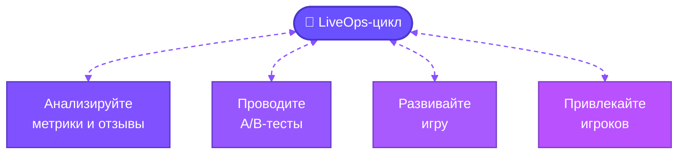

# Оперирование игрой

LiveOps (Live Operations) — это оперирование игрой после ее релиза: отслеживание метрик, регулярные обновления, управление событиями, работа с сообществом и A/B-тесты. Чем активнее вы работаете с игрой, тем дольше она живет, больше игроков в нее возвращаются и стабильнее ваш доход.

Вы можете управлять оперированием прямо из [Консоли разработчика](https://games.yandex.ru/console){.external} — без сложной инфраструктуры и лишних затрат.

## Шаг 1. Анализируйте {#analysis}

Следите за состоянием игры с помощью [инструментов аналитики](https://yandex.ru/dev/games/doc/ru/concepts/analytics.md) в Консоли — они помогут найти точки роста и вовремя среагировать на проблемы.

### Метрики {#metrics}

- [Общий доход](https://yandex.ru/dev/games/doc/ru/console/total-income.md) — сводная финансовая картина по всем играм.
- [Панель управления](https://yandex.ru/dev/games/doc/ru/console/control-panel.md) — обзор ключевых показателей и алерты о важных изменениях: снижении метрик, проблемах с игрой.
- [Метрики](https://yandex.ru/dev/games/doc/ru/concepts/metric.md) — детальная статистика по продуктовым, денежным и техническим показателям. Игры с рейтингом 80+ и метрикой **Средний доход на одного игрока в день (ARPDAU)** > 2 ₽ обычно приносят ощутимый доход.
- [Метрики покупок](https://yandex.ru/dev/games/doc/ru/console/purchase-metrics.md) — статистика по инап-покупкам: кто платит, что покупают, как растет выручка.

### Отзывы {#reviews}

Оставляйте официальные ответы на [отзывы игроков](https://yandex.ru/dev/games/doc/ru/console/reviews.md) и учитывайте их пожелания при доработке игры.

## Шаг 2. Проводите A/B-тесты {#ab-testing}

Принимайте решения на основе данных — проверяйте гипотезы с помощью инструментов A/B-тестирования.

### Для развития игры {#ab-development}

- [A/B-тесты версий](https://yandex.ru/dev/games/doc/ru/console/ab-builds.md) — оцените влияние крупных изменений на метрики: покажите экспериментальную сборку игры части аудитории.
- [Эксперименты](https://yandex.ru/dev/games/doc/ru/console/vq-test.md) с флагами — тестируйте небольшие изменения через удаленную конфигурацию без выпуска новой версии.

### Для привлечения игроков {#ab-promotion}

- [A/B-тест иконок](https://yandex.ru/dev/games/doc/ru/concepts/ab-test.md) — сравните варианты иконок и обложек, чтобы повысить конверсию в запуск игры из каталога.

## Шаг 3. Развивайте игру {#development}

Регулярные обновления, эксперименты и новые механики удерживают игроков и улучшают метрики.

### Выпускайте обновления {#updates}

- Исправляйте баги.
- Повышайте качество контента, добавляйте новый.
- Учитывайте изменения правил платформы в новых версиях игры. Чтобы быть в курсе изменений, заглядывайте в [историю изменений](https://yandex.ru/dev/games/doc/ru/release-notes.md) и следите за обновлениями в нашем [телеграм-канале](https://t.me/yangamesdevnews){.telegram} и [сообществе ВКонтакте](https://vk.ru/yandexgmsdev){.vk}.

### Управляйте удаленной конфигурацией {#remote-config}

С помощью [флагов](https://yandex.ru/dev/games/doc/ru/config.md) вы можете менять настройки игры в реальном времени, без загрузки нового архива и модерации. Например, балансировать сложность, включать акции или постепенно внедрять новые функции.

### Добавьте лидерборды {#leaderboards}

[Лидерборды](https://yandex.ru/dev/games/doc/ru/concepts/leaderboards.md) показывают игроку его место среди других — это мотивирует возвращаться и соревноваться.

## Шаг 4. Привлекайте игроков {#promotion}

Чем больше игроков, тем выше доход. Используйте [инструменты продвижения](https://yandex.ru/dev/games/doc/ru/concepts/promotion.md), чтобы расти быстрее.

### Запускайте платное продвижение {#paid}

Когда у игры будет [зеленый рейтинг](https://yandex.ru/dev/games/doc/ru/concepts/metric.md#product) и [ARPDAU](https://yandex.ru/dev/games/doc/ru/concepts/metric.md#monetization) не менее 1,5 ₽, запустите [платное продвижение](https://yandex.ru/dev/games/doc/ru/concepts/start-screen.md) — рекламу в каталоге и на страницах других игр.

### Добавляйте промоакции {#promos}

[Промоакции](https://yandex.ru/dev/games/doc/ru/console/promo-and-discounts.md) помогают привлечь игроков, увеличить инап-покупки и оживить сообщество. Приурочьте акцию к тематическому событию Яндекс Игр или запустите свою.
